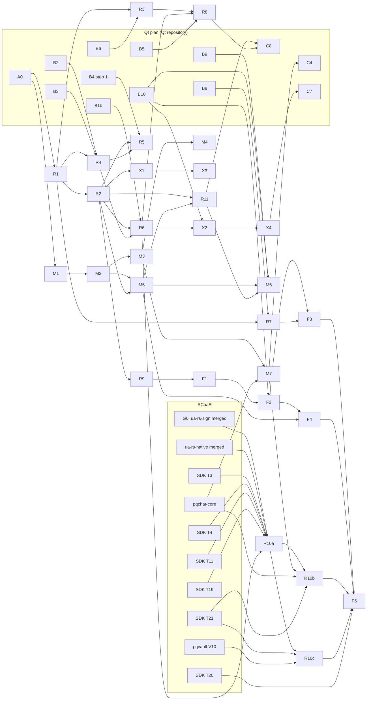

# scaas-app: Rust app core, Matrix, Dioxus and Flutter: plan

Status: **PLANNED**. Nothing in this file is built. Everything cryptographic these tasks use is `UNAUDITED`.

This file is the reference for groups R (`app-core-rust`), M (`app-matrix`), X (`app-rust`, Dioxus) and F (`app-flutter`).
Groups R, M and X come from the Qt repository's plan, `scaas-qt-wallet-client/docs/superpowers/plans/2026-11-17-scaas-app-next.md`
(version 8), translated with their task ids and then updated by the owner's rulings below. Group F is new. Owner 2026-11-17: "Ok,
theo đề xuất, chuyển sang scaas-app" (OK, as proposed, move to scaas-app). The Qt plan keeps groups A (docs), B (`app-core-qt`, the
default build) and C (the `scaas` build of `app-core-qt`), and keeps a Vietnamese copy of R, M, X and F updated from this file
(owner: English is the reference; a Vietnamese copy, where one exists, is kept and brought up to date).

**Ids.** R1–R11, M1–M7, X1–X4 and F1–F5 are tasks of this file. "Qt plan B5" is task B5 of the Qt plan. R1–R10 of the Qt
repository's review spec (`docs/superpowers/specs/2026-11-17-scaas-app-review.md`, section 0) are owner rulings, not these tasks;
D1–D16 are the decisions of its `2026-11-17-scaas-app-three-frontends.md`, section 9. SCaaS tasks are named by their plan in the
SCaaS repository: "SDK T3" is task T3 of `docs/superpowers/plans/2026-11-17-scaas-sdk.md` (branch `scaas-sdk`), "pqvault V10" of
`docs/superpowers/plans/2026-11-17-pqvault.md` (branch `pqvault`), "ua-rs-native" the plan `2026-11-17-ua-rs-native.md` (branch
`ua-rs-native`). The contract is [`app-common/spec/app-core-contract.md`](../../app-common/spec/app-core-contract.md).

> **For the executing agent:** do the tasks of a group in order. Each task: a failing test first, the smallest change, the test
> green, then stop at the working tree. Commit only when the owner says. No push.

## Owner rulings applied (2026-11-17)

1. Groups R, M, X move to this repository; group F (Flutter) is added.
2. App cores sit above `scaas-sdk`. `app-core-rust` is the app's one Rust library, with the Cargo features `native-core` (on by
   default: the app core of contract sections 1 to 8), `scaas` (`scaas-sdk`, `ua-rs`), `pqchat` (`pqchat-core`, implies `scaas`) and
   `pqvault` (`pqvault-core`, implies `scaas`). Contract section 12.
3. The Rust and Flutter front-ends link it whole. The Qt front-end has two paths, chosen by the CMake option `SCAAS_QT_CORE`:
   `cpp` (the default), `app-core-qt` plus `app-core-rust` without `native-core`, with a build check that refuses a `native-core`
   symbol; `rust`, `app-core-rust` whole through its C ABI. One thin adapter serves both paths; CI runs the Qt UI's tests on both
   (Qt plan C8).
4. In the `scaas` build the SDK opens the vault (SDK spec Q-A1 (a)); the app core never holds the mnemonic there. `evm` and `hedera`
   go through the SDK's `EvmTx`; every other chain is encoded by backend (a) or (b) and signed by the SDK's guarded raw entry.
   `cosmos` and `gram` are an open point (contract section 10, point 11).
5. One runtime, one Matrix client, one SDK instance per process.
6. `pqchat-core` takes `app-matrix`'s live client. That replaces M7's former wording.

## Shared constraints

- A SCaaS kind (UA, `mtx*`, PQZ, Zether, PqChat) is never signed, derived or encoded in backend (a) or (b), in any build. Only
  `scaas-sdk` → `ua-rs`, behind the feature `scaas`.
- Exactly one backend per chain in a build.
- Build variants by Cargo features (CMake options on the Qt side) and compile-time constants. Nothing is generated to drop functions.
- The same mnemonic gives the same addresses in every build and every backend.
- Never edit a pin, a vector or a test to go green. Two backends disagree: stop and report both values.
- In the Qt repository (M6): do not read `src-backend-ignore/`; no port of Nim code.
- Qt, Trust Wallet Core and cargo builds run in the foreground, one at a time.
- New files carry `SPDX-License-Identifier: LicenseRef-Vegan-Community-1.0`. No Status file in this repository; a file in the Qt
  repository that derives from Status keeps MPL-2.0 (D9).
- No absolute machine path in a committed file.
- This repository: docs, code identifiers and commit messages in English.

## SCaaS-side dependencies

Only the features `scaas`, `pqchat` and `pqvault` wait for these. Everything else waits for nothing on the SCaaS side.

| Id | What | Planned in |
|---|---|---|
| G0 | `ua-rs-sign` merged into the SCaaS `main` | SCaaS plan `2026-11-05-ua-rs-sign.md` |
| ua-rs-native | `ua-rs-native` merged: Bitcoin, NEAR, Polkadot and the envelope calls (the Qt plan's gaps U1–U5) | ua-rs-native T0–T13 |
| SDK T3 | the bindings spike; it decides Q-B1: (a) UniFFI with `uniffi-bindgen-cpp`, or the fallback (b), `app-core-rust`'s own C surface | SDK plan |
| SDK T4 | `vault`: the SDK opens the vault v1 file | SDK plan |
| SDK T11 | `wallet`: EVM native send (`EvmTx`) | SDK plan |
| SDK T19 | native networks and the guarded raw entry (`raw-native`) | SDK plan |
| SDK T20 | the generated bindings over the whole surface (FRB, C++) | SDK plan |
| SDK T21 | the `app_core` surface app cores use (key handles, app record signing) | SDK plan |
| pqvault V10 | `pqvault-core`; that plan's V11 is task R10c here | pqvault plan |
| pqchat-core | `pqchat-core`, an app core above the SDK; it owns its attachment to the app's Matrix client (SDK spec section 12.1) | no plan with task ids yet (SCaaS UA-7 plan, section "Clients") |

## Group R: `app-core-rust` (D14)

Starts when Qt plan A0 is done. Runs in parallel with Qt group B, reported apart. Location (D16, settled again by review ruling R8):
`app-core-rust/` in this repository, its own Cargo workspace, SCaaS SPDX, no Qt dependency.

| Task | Work | Depends on | Gate |
|---|---|---|---|
| R1 **[changed]** | Crate frame: `app-core-rust/Cargo.toml`, `crate-type = ["staticlib", "cdylib", "rlib"]`; features `native-core` (default: vault, native derivation and signing, backends, endpoint lists), `scaas` (`scaas-sdk`, `ua-rs`; empty until the SDK exists), `pqchat` (`pqchat-core`, implies `scaas`), `pqvault` (`pqvault-core`, implies `scaas`); `rust-toolchain.toml` shared with Qt plan B4 step 1 | Qt A0, D16 | `cargo build`; `cargo build --no-default-features`; `cargo build --features scaas` (and `pqchat`, `pqvault`) fails with a clear message while the SDK or the app core is missing; a test that `pqchat` and `pqvault` each turn `scaas` on; `cargo clippy -- -D warnings` |
| R2 **[changed]** | C ABI: header generated by cbindgen, functions return the numbered error codes of contract section 7, one ABI-version function. No secret leaves; the caller holds handles. The `native-core` calls (vault, `derive`, `sign`, endpoint lists) compile only with that feature; the ABI version and the error mapping always | R1 | header drift test; a small C test calls `derive`; the header of a `--no-default-features` build holds no `native-core` call |
| R3 | Vault in the contract's format (D12): open, seal, one envelope per seed; KDF parameters outside the allowed set refused before the KDF runs. Feature `native-core` | R1, Qt B6 fixing the format | a vault written by `app-core-qt` opens here, and the reverse |
| R4 | Path table and chain-to-backend table from the contract, as constants; static check: one backend per chain. Feature `native-core` | R1, Qt B2, B3 | the address vector rows pass |
| R5 | Trust Wallet Core backend through TWC's C ABI; always passes the table's path. Feature `native-core` | R2, R4, Qt B4 step 1 | the vector rows of the chains at (b) pass |
| R6 | TxCodec backend through `cxx`, from `app-common/txcodec/`. Precondition: Qt B1b including its move step. Feature `native-core` | R2, R4, Qt B1b | the vector rows of the chains at (a) pass; no Qt symbol in the library |
| R7 | Endpoint lists by contract section 6 (storage format, failover for reads only). Feature `native-core` | R1, Qt B8 | the same tests as Qt B8, on a fake transport |
| R8 | Cross-check of the two cores, one CI job in the Qt repository: check out this repository at a pinned commit, build `app-core-rust` with `native-core`, read `app-common/vectors/` | R3–R6, Qt B5 | same mnemonic → same addresses; same unsigned transaction → same bytes (randomized schemes: signatures cross-verified); vault both ways; one negative row per chain. The two-path CI of Qt C8 adds to this gate; it does not replace it |
| R9 **[changed]** | flutter_rust_bridge over the library's surface; in a `scaas` build the SDK's generated surface (SDK T20) is part of the same library | R2; when group F starts | `dart test` on the Linux `.so` |
| R10a **[changed: R10 split]** | Feature `scaas`: `scaas-sdk` as a dependency, and through it `ua-rs` and `scaas-rpc`; one SDK instance per process, on the library's one runtime. The SDK opens the vault v1 file itself (Q-A1 (a)): under `scaas` the core's own seed-opening path is not compiled, and backends (a) and (b) get no `unlock`; they encode and assemble only. Backend (c) by contract section 4, rule 5: `evm` and `hedera` encoded and signed by the SDK's `EvmTx`; `bitcoin`, `near`, `solana`, `stellar`, `sui`, `aptos`, `polkadot`: the preimage built by (b) or (a), signed by the SDK's guarded raw entry, the transaction assembled by the backend. `cosmos` and `gram` are not mapped: open point 11 of contract section 10, a question for the SCaaS owner; the task stops there and never opens the seed in the core instead. Without `native-core` (the Qt `cpp` path) the feature links the SDK and its binding surface only; backend (c) is then `app-core-qt`'s (Qt C2) | G0, ua-rs-native, SDK T3, T4, T11, T19; R3–R6 | as Qt C1, C2: ABI version and feature bits checked at load, the `vectors` bit off; R8's rows pass through (c) for every mapped chain; a symbol test: no seed-opening call of the core in a `scaas` build; the preimage only from a transaction built in this process; the review shows the decoded transaction before signing; no raw path for an EVM key or a UA key |
| R10b **[new, from R10]** | Feature `pqchat` (implies `scaas`): `pqchat-core` as a dependency; it takes `app-matrix`'s live client (M7) and runs on the library's runtime | R10a, M7, pqchat-core, SDK T21 | one login serves Matrix chat and PqChat; `cargo tree` holds one `matrix-sdk`; without the feature, no `pqchat` symbol |
| R10c **[new, from R10]** | Feature `pqvault` (implies `scaas`): `pqvault-core` as a dependency. This is pqvault V11 | R10a, pqvault V10, SDK T21 | `cargo tree`: `pqvault-core` reaches keys and nodes only through `scaas-sdk`; one SDK instance shared with R10a and R10b; without the feature, no `pqvault` symbol |
| R11 **[new]** | The Qt-facing build: `cargo build --no-default-features` plus the features the Qt build asks for (none, `scaas`, `pqchat`, `pqvault`), one static library for Matrix, the SDK and the app cores. A check script (name proposed: `scripts/check-no-native-core.sh`) lists the library's symbols and refuses a `native-core` symbol: a C ABI name of R2's `native-core` calls, a Rust symbol under the crate's `native-core` module, a TxCodec or Trust Wallet Core symbol | R2, M5 | the check passes for each Qt-facing feature set; positive control: it fails on a default-features build, and that red run is recorded; Qt C8 runs it in the Qt build |

What changed in meaning against the Qt plan's version 8:

- **R1:** one feature `scaas` became the four features of contract section 12; `native-core` is on by default and can be switched off.
- **R2:** the `native-core` calls are behind that feature, so a Qt-facing build exports none of them.
- **R9:** the bridge covers the whole library, the SDK's surface included in a `scaas` build.
- **R10:** split into R10a (`scaas`), R10b (`pqchat`), R10c (`pqvault`). Backend (c) no longer means "`ua-rs` signs every native
  preimage after the core hands it the mnemonic": the SDK opens the vault, `EvmTx` takes `evm` and `hedera`, the guarded raw entry
  the rest, and `cosmos` and `gram` stay unmapped until the SCaaS owner answers. The dependencies moved from G2 and U1–U5 to SDK
  T3, T4, T11, T19 and `ua-rs-native`.
- **R11:** new; it is the build check of ruling 3.

## Group M: Matrix chat (`app-matrix`, D5)

Does not wait for SCaaS. The crate is in this repository, directory `app-matrix/` (proposed; no toolkit). M6 is the Qt part: its
code and commits are in the Qt repository. Contract: section 11.

| Task | Work | Depends on | Gate |
|---|---|---|---|
| M1 **[changed]** | Crate frame `app-matrix`: `matrix-sdk` pinned to exactly one stable version with `=` (check the current one when the task runs), feature `e2e-encryption` and the SQLite store; `crate-type = ["rlib"]`: a binary links it only through `app-core-rust` (one library per app; two static libraries would be two clients); the shared `rust-toolchain.toml` | Qt A0 | `cargo build`, `cargo clippy -- -D warnings`, `cargo deny` for licences |
| M2 | Login and session: homeserver (`https` only, `.well-known` discovery), password or SSO; one session per app; the session restored when the app opens; logout deletes the store. The store key, 32 random bytes, sits in the operating system's secret storage; the Matrix password is not stored | M1 | test against a fake homeserver in the process, or a local container with a memory cap; no token in a log or an error |
| M3 | Rooms, timeline, send: room list, paged timeline, incoming messages, send text; a new 1:1 room is encrypted; an unencrypted room carries a flag for the UI to label | M2 | two clients in a test send and receive one encrypted message; a message that cannot be decrypted shows that state, never empty |
| M4 | Verification and key backup: cross-signing, device verification by SAS (emoji) and QR, a recovery key shown once, optional server-side key backup; an unverified device carries a flag | M3 | two test devices verify each other; history restored with the recovery key |
| M5 **[changed]** | C ABI of `app-matrix` (cbindgen), one event callback, error codes by the contract; exported from `app-core-rust`'s library in every feature set, `--no-default-features` included. `app-core-rust` depends on `app-matrix` always and owns the one tokio runtime the client runs on | M2, R2 | header drift test; the Matrix calls are present in a `--no-default-features` build |
| M6 **[changed]** | Qt (Qt repository): `src/chat/ChatController.*` and the C++ model over M5's C ABI; callbacks reach the GUI thread by queued signal; the fork's chat screen wired by the view-model contract. The default build links `app-core-rust` built without `native-core` (R11) for Matrix, not `app-matrix` on its own; check F-13 | M5, R11, Qt B9, B10 | `tst_chat_controller` with a fake core; the default build links together with TWC and `sr25519_ffi`; R11's check passes; QML holds no token |
| M7 **[changed]** | The PqChat attachment: `pqchat-core`, an app core above the SDK, takes `app-matrix`'s live client inside `app-core-rust` with the feature `pqchat` (contract section 11.2, SDK spec section 12.1). `app-matrix` hands out the client, delivers every `net.scaas.pqchat.v1` event to the attached `pqchat-core`, and at logout lets it release first. The attachment, its release, the shared runtime and events that arrive while a seed is locked are `pqchat-core`'s rules. In the default build an event of that type shows as "needs the SCaaS build", never as an ordinary message | M3, pqchat-core | `pqchat` build: one login serves both; `cargo tree` holds one `matrix-sdk`; logout waits for the release (a test); the default build has no `pqchat` symbol |

What changed in meaning:

- **M1:** no static library of its own; only `app-core-rust` is linked into a binary.
- **M5:** the C ABI ships inside `app-core-rust`'s library, with `native-core` on or off; the runtime belongs to that library.
- **M6:** the Qt default build links `app-core-rust` without `native-core`, not `app-matrix`.
- **M7:** was "`app-matrix` lets `pqchat-core` send and receive `net.scaas.pqchat.v1` events through the same client"; now
  `pqchat-core` takes the live client and owns the attachment rules. Its dependency G3 (`pqchat-core` plus an SDK module `chat`)
  became `pqchat-core` alone: the SDK has no `chat` module.

## Group X: `app-rust` (Dioxus, D3)

In this repository, directory `app-rust/`. After group R: it links `app-core-rust` as a crate. Desktop first; mobile is
Flutter's (D2).

| Task | Work | Depends on | Gate |
|---|---|---|---|
| X1 **[changed]** | Dioxus crate frame: exactly one stable version pinned with `=` (check the current one when the task runs; SCaaS research `pqchat-client-options.md` §11.3 recorded 0.7.10), no alpha; a path dependency on `app-core-rust`, whole (`native-core` on); the features `scaas`, `pqchat`, `pqvault` forwarded to it; the process's one tokio runtime is the library's | R1, R2 | `cargo build`, `cargo clippy -- -D warnings`; a desktop window opens on Linux |
| X2 | Native screens by the view-model contract: unlock, accounts, receive, send and review | R3–R6, Qt B10 | the same test mnemonic gives the same addresses as the Qt front-end; no signing call other than `sign(chain, unsignedTx)` |
| X3 | Keep the vault file and the KEK behind the operating system's gate with a Rust crate | X1 | a vault written here opens in the Qt front-end |
| X4 | Test on each WebView: WebKitGTK, WebView2, WKWebView; one Telex and VNI test through the operating system's input method | X2 | results in the spike report (Qt C7) |

What changed in meaning: **X1** forwards `pqchat` and `pqvault` beside `scaas`, links the library whole, and uses the library's
runtime (ruling 5).

## Group F: `app-flutter` (Flutter front-end) [new]

In this repository, directory `app-flutter/`. The mobile front-end (D2). It reaches `app-core-rust`, linked whole, through
flutter_rust_bridge (R9). A frame: each task is written out in full when its dependencies land.

| Task | Work | Depends on | Gate |
|---|---|---|---|
| F1 | Project frame over FRB: Flutter stable and FRB each pinned to one version (FRB the one of R9); the library loaded, its ABI version and feature bits checked at load (`AbiMismatch`), the `vectors` bit off in a release; Linux desktop first, then Android, then iOS | R9 | `flutter test` on Linux; the app starts on Linux; the Android build of the library recorded (D2: Flutter must show FRB builds for Android and iOS) |
| F2 | The view model: Dart models, actions, events and flow states by `app-common/viewmodel/view-model-contract.md` | F1, Qt B10 | one test per screen's flow over a fake core; no name outside the contract |
| F3 | Screens for the vault (create, import with the `short_seed` warning, unlock, lock), accounts and receive, send with review (the decoded transaction shown before `sign`) | F2, R3–R7 | the same test mnemonic gives the same addresses as the Qt front-end; a vault written here opens in the Qt front-end; no signing call other than `sign(chain, unsignedTx)`; Telex and VNI on a real device (D2), recorded in Qt C7's spike report |
| F4 | Chat over `app-matrix`, through R9: login, room list, timeline, send, device verification, recovery key (contract section 11.6); an unencrypted room labelled; a Matrix conversation never shown as post-quantum | F2, M2–M5 | M3's two-client test through the Flutter layer; an undecryptable message shown as such |
| F5 | The `scaas` build's screens: UA accounts, `mtx*` review with named fields and job state, PqChat (1:1 first), PqVault, Zether and PQZ balances as two separate fields | F3, F4, R10a–R10c, SDK T20 | a build without `scaas` has no SCaaS symbol; each screen lands with its SDK module's task |

## Order and dependencies

- Nothing in R1–R9, R11, M1–M6, X1–X4 and F1–F4 waits for SCaaS. R1 and M1 start as soon as Qt A0 is done (its first version is
  written); R3–R7 each wait for the Qt B task that fixes their contract section.
- M1–M4 do not wait for group R; M5 waits for R2, so that the Matrix C ABI ships in the one library.
- X waits for group R. F waits for R9 and Qt B10.
- R10a, R10b, R10c, M7 and F5 wait for the SCaaS tasks named in their rows. Of those, SDK T3 decides how C++ reaches the SDK
  (Q-B1), which Qt C1 and C8 follow.
- Qt C8 (the two Qt paths) waits for R2–R7 and R11 here; Qt C4 (PqChat in Qt) waits for M7 and R10b.

## Self-check

- D14 → group R, R8 (the cross-check of the two cores); the two Qt paths → R11 and Qt C8.
- D5 / review ruling R10 → group M (Matrix chat in the default build), M7, R10b and Qt C4 (PqChat through the same client).
- Ruling 2 (the four features) → R1, R10a–R10c; ruling 4 (the SDK opens the vault) → R10a; ruling 5 (one runtime, one client,
  one SDK) → M5, R10a–R10c, X1; ruling 6 → M7.
- No task puts a SCaaS kind in backend (a) or (b), and no task opens the seed in the core in a `scaas` build.
